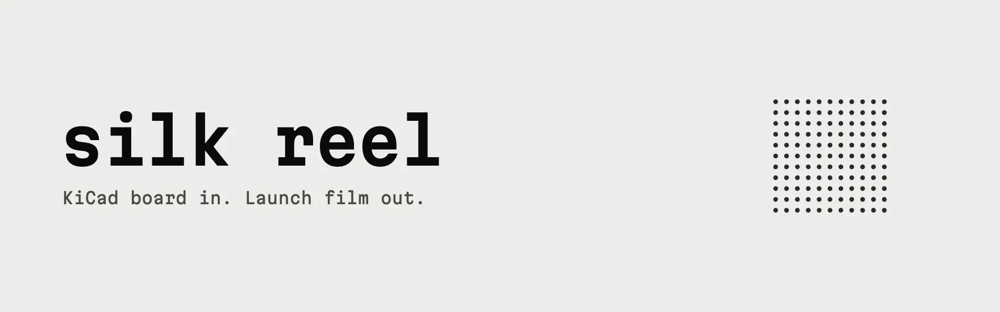
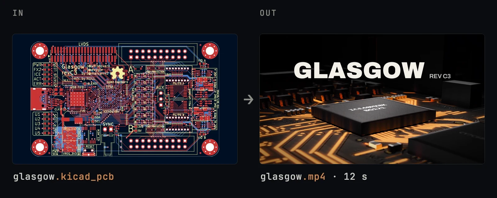
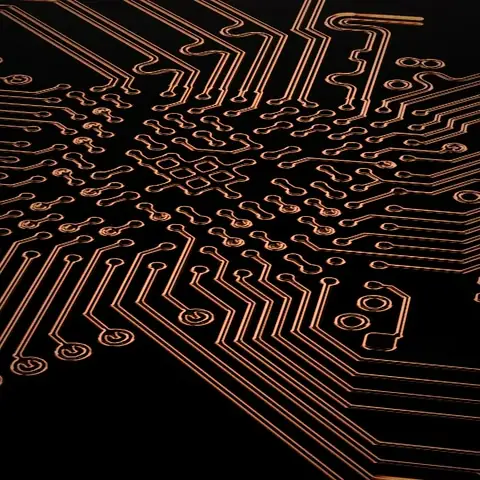
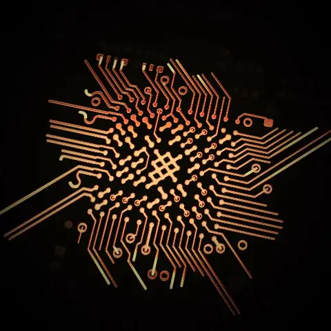
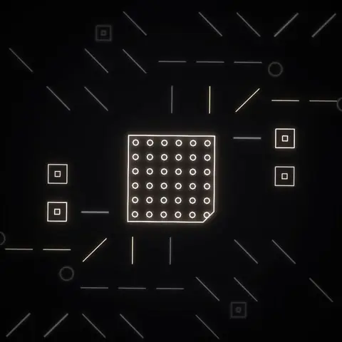

<p align="center">
  <picture>
    <source media="(prefers-color-scheme: dark)" srcset=".github/assets/banner-dark.webp">
    
  </picture>
</p>

<p align="center"><b>Your KiCad board, as a launch film.</b><br />A command-line tool and a browser studio that turn a <code>.kicad_pcb</code> into a 12-second film of that exact board, with sound.</p>

<p align="center">
  
  
  
</p>

<p align="center">
  <a href="https://silkreel.hridya.tech/studio"><b>Try it on your board</b></a>
  &nbsp;·&nbsp;
  <a href="https://silkreel.hridya.tech/docs">Docs</a>
  &nbsp;·&nbsp;
  <a href="https://silkreel.hridya.tech">Website</a>
</p>

You spent months on the board. It deserves better than a phone photo on a desk.

silk reel reads the board file and films it. The copper routes out of your main chip. The mask goes on. Every part lands on its pads. Then the board powers on, and the camera holds on a poster frame with the board's name. Nothing is stock footage. Every trace, pad and label in the film is in your file.

<p align="center">
  <a href="https://silkreel.hridya.tech"></a>
</p>

<p align="center"><sub>The Glasgow interface explorer, from its board file alone. On the <a href="https://silkreel.hridya.tech">website</a> it plays with its score.</sub></p>

## One file in, one film out

<p align="center">
  
</p>

The film is 360 frames on a 24-beat grid. Each beat comes from your board:

```text
+-[ glasgow.mp4 ]----------------------+
|                                      |
|  ●   0.0 s  Copper leaves the chip   |
|  │                                   |
|  ●   2.5 s  Mask covers the copper   |
|  │                                   |
|  ●   3.5 s  Silkscreen prints        |
|  │                                   |
|  ●   3.7 s  Parts land, once         |
|  │                                   |
|  ●   6.0 s  Power on                 |
|  │                                   |
|  ○  10.0 s  The poster frame holds   |
|                                      |
+--------------------------------------+
```

silk reel picks the main chip itself: the IC that carries the most signals. Name another with `--hero U3`.

## Four looks

| Trace | Montage |
|:---:|:---:|
|  |  |
| **The lit board.** A studio floor, real part models, one power-on. | **The trailer cut.** Build, stop, release, poster. Add your own lines with `--line`. |
| **Glyph** | **Plot** |
|  |  |
| **Parts as type.** The board's own parts and words, set as glyphs, ending on its name. | **A blueprint.** The board drafted in pale ink on navy, ending on a title sheet. |

Every look renders at 4:5, 1:1, 9:16 or 16:9, so one board gives you the post, the story and the banner. Each look has its own score: CC0 music by human artists, cut so its biggest moment lands on the film's turn.

## Any board

<p align="center">
  
</p>

<p align="center"><sub>iCEBreaker · Glasgow · StickHub<br />ECC83 preamp · ColdFire dev kit · KiCad video board</sub></p>

An FPGA board, a USB hub, a valve preamp and a 312 mm PCI card. Each film came from its board file. The only flags were `--title` and `--aspect`. silk reel uses each part's own 3D model when KiCad can find it.

## Quick start

Install Node.js 22 or later, and put `ffmpeg` and `ffprobe` on your PATH.

```bash
git clone https://github.com/hridaya423/silkreel
cd silkreel
npm ci
npm run reel -- path/to/your-board.kicad_pcb --title "Your Board" --version v1.0
```

The film lands beside your board as `<board>-trace-4x5.mp4`, with `<name>.poster.png`, its last frame, for a cover image. The first render downloads a headless Chrome. Later renders reuse it.

If your machine has no GPU, put `SILK_REEL_GL=swangle` in front of the command. silk reel reads KiCad 4 and later. It does not read Gerber, Eagle or Altium files.

## Options

| flag | values | default |
|---|---|---|
| `--style` | `trace` · `montage` · `glyph` · `plot` | `trace` |
| `--aspect` | `4:5` · `1:1` · `9:16` · `16:9` | `4:5` |
| `--format` | `mp4` · `gif` · `webm-alpha` · `prores-alpha` | `mp4` |
| `--title`, `--version` | the board's name and revision on the title card | the silkscreen, else the title block |
| `--hero` | the part the film is about, e.g. `U3` | the chip that carries the most signals |
| `--mask` | `green` · `black` · `white` · `blue` · `red` · `yellow` · `purple` (trace and montage) | the board file's, else `green` |
| `--palette` | `copper` · `mono` · `blueprint` · `phosphor` · `paper` · `cyanotype` | per style |
| `--line` | up to three lines of your own in the montage's build | none |
| `--ending` | glyph's last shot: `parts` or `routes` | `parts` |
| `--music` | your own track, cut to the film | the style's score |
| `--no-audio` | a silent film | off |
| `--seed` | any number; each one gives a different variation | `42` |
| `--credit` | a small "made with silk reel" line | off |

Run `npm run reel -- --help` for every flag. The alpha formats have a transparent background, so you can put the film over your own footage. The same board and flags always render the same film.

### Part models

A trace film shows each part's own 3D model when it finds the STEP file. It reads the model paths in your board the way KiCad does. Add more folders with `--models DIR`. A part without a model keeps an estimated body, and the CLI lists it.

## Share your film

Post the MP4 as it is, or use `<name>.poster.png` as the cover. To credit the tool, add `--credit`. It puts a small "made with silk reel" line on the held last frame of a trace or plot film, and through the whole glyph film. The studio has the same switch. It is off by default.

## Studio

The [browser studio](https://silkreel.hridya.tech/studio) previews every look for your own board. The tab reads your board file and does not upload it. It records WebM, saves stills, and writes the CLI command for the other formats.

To render every format from a queue, run the studio and the render API on your machine. The studio shows a Render button while the API answers:

```bash
npm run start --workspace=@silk-reel/render-api   # render API on :3102
npm run dev --workspace=@silk-reel/site           # studio at http://localhost:4321/studio/
```

## How it works

1. [`ingest`](packages/ingest) parses the `.kicad_pcb`: outline, copper on every layer, pads, vias, zones, footprints and silkscreen.
2. [`choreo`](packages/choreo) compiles the board into a timeline. It picks the main chip and solves the shot list for each board and each aspect.
3. [`render`](packages/render) draws each frame. Trace uses WebGL2 with depth of field, HDR bloom and motion blur.
4. [`render-api`](packages/render-api) encodes the frames with Remotion and ffmpeg, and adds the score, mastered to −14 LUFS.

[`cli`](packages/cli), [`site`](packages/site) and [`metrics`](packages/metrics) hold the CLI, the website with its studio, and the video probes. The banner at the top of this page is Glasgow's front copper, drawn by [`.github/assets/banner.mts`](.github/assets/banner.mts).

## Development

```bash
npx tsc --noEmit         # typecheck
npx vitest run           # tests
npx eslint packages      # lint
```

Every change to how a film looks goes through a full-video review. [AGENTS.md](AGENTS.md) has the commands and the rubric.

## Credits

- **Sample boards:** [iCEBreaker](https://github.com/icebreaker-fpga/icebreaker) © 2019 1BitSquared, CC BY-SA 4.0. [Glasgow](https://github.com/GlasgowEmbedded/glasgow) rev C3, Glasgow Embedded, 0BSD. StickHub, the ECC83 preamp, the ColdFire dev kit and the video board are KiCad demo projects.
- **Sound:** CC0 recordings and music from Freesound, OpenGameArt and the Free Music Archive, listed in [CREDITS.md](packages/render-api/assets/sound/CREDITS.md).
- **STEP reading:** [occt-import-js](https://github.com/kovacsv/occt-import-js) and Open CASCADE Technology, both LGPL 2.1, used unmodified as an npm dependency.
- **Type:** title cards use JetBrains Mono Medium and Bold, v2.304 from the [official release](https://github.com/JetBrains/JetBrainsMono/releases/tag/v2.304) (SIL Open Font License 1.1, [`OFL.txt`](packages/render/src/assets/OFL.txt)), bundled so renders match on every machine.
- **Drafting type:** the blueprint film letters its callouts, panel titles and title block in Silk Draft, a modified version of Routed Gothic by Darren Embry (the regular weight from the [author's repository](https://github.com/dse/routed-gothic), SIL Open Font License 1.1, [`OFL-RoutedGothic.txt`](packages/render/src/assets/OFL-RoutedGothic.txt)). Silk Draft gives the 1 a flag and a foot and slashes the 0, so designators never read as I and O; [`scripts/silk-draft-font.py`](scripts/silk-draft-font.py) builds it from the original, and it is renamed because "Routed Gothic" is a Reserved Font Name.
- **Banner type:** Martian Mono by Evil Martians, SIL Open Font License 1.1, the website's own typeface.

## License

silk reel is licensed under the [Apache License 2.0](LICENSE). The sample boards, the sound recordings and the fonts keep their own licenses, listed under Credits.
